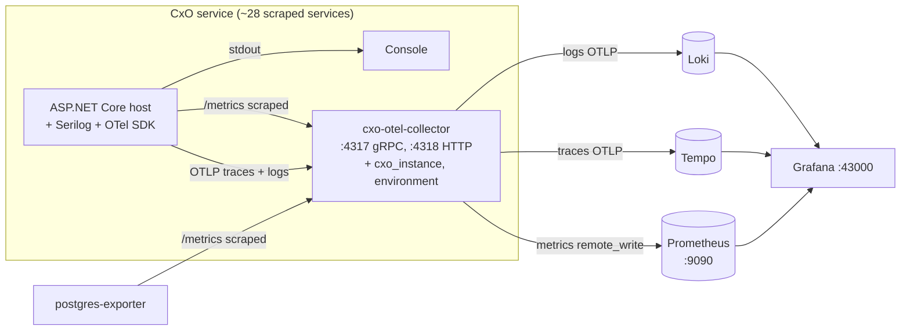
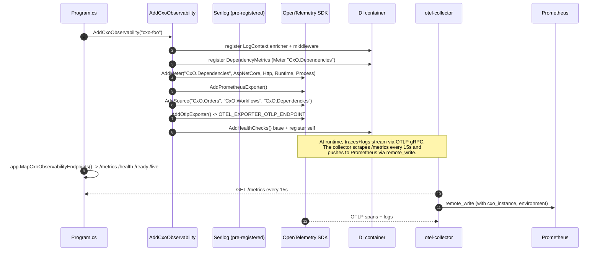
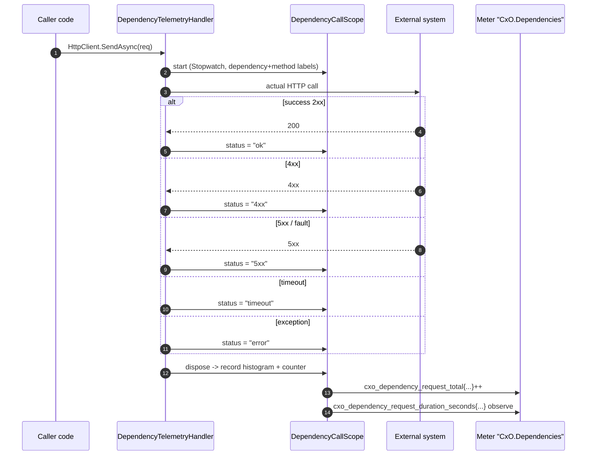
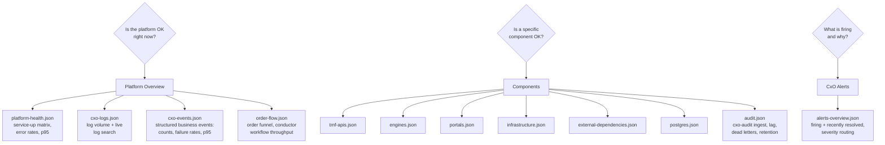

# CxO Monitoring — Developer Overview

> **Audience.** CxO platform developers who need to wire observability into a service, read a dashboard, or chase a problem in production. This is the front door; deep-dives live in the per-component docs linked at the end.

## 1. The stack at a glance

Every CxO service emits **three signals** — logs, metrics, traces — into a shared platform stack. The runtime path looks like this:



> The collector is the single egress point for the CxO tier. It scrapes `/metrics` from every CxO service, postgres-exporter, and Conductor, then pushes to Prometheus via `remote_write`. Prometheus is configured with `--web.enable-remote-write-receiver` and only self-scrapes its own internal metrics. The collector stamps `cxo_instance` and `environment` resource attributes on every signal — see §3.9.

| Component | Local port | Purpose |
|---|---|---|
| **Serilog** (in-process) | — | Structured logging library, configured by the CxO.Observability bootstrap. Default sinks: Console + OTel→Loki. |
| **OpenTelemetry SDK** (in-process) | — | Emits metrics + traces (+ logs). Configured by `CxO.Observability`. |
| **cxo-otel-collector** | 4317 (gRPC), 4318 (HTTP) | **Single egress point** for the CxO tier. Scrapes `/metrics` from every CxO service, postgres-exporter, and Conductor every 15s, then pushes to Prometheus via `remote_write`. Receives OTLP logs and traces and routes them to Loki and Tempo. Stamps `cxo_instance` + `environment` resource attributes on every signal. |
| **Prometheus** | 9090 | Receives platform metrics via `remote_write` push from the OTel collector (started with `--web.enable-remote-write-receiver`). Self-scrapes its own internal metrics. Retention is the image default (~15 days) locally. |
| **Loki** | 3100 | Log storage queried with LogQL. Receives logs via OTel collector → OTLP. |
| **Tempo** | 3200 | Trace storage. Receives spans via OTel collector → OTLP. |
| **Grafana** | 43000 | Single pane for dashboards, ad-hoc queries against Prometheus / Loki / Tempo, and Grafana-managed alerts (rules provisioned; no contact point). |
| **postgres-exporter** | (sidecar) | Translates Postgres internal stats into Prometheus metrics. Scraped by the OTel collector. One per cluster (app + Conductor). |

A service is "wired in" when (a) the OTel collector can scrape its `/metrics` (a new target is added to the `prometheus` receiver in `files/monitoring/otel-collector/config.yml`, **not** to `prometheus.yml`), (b) it ships logs+traces to the collector, and (c) it answers `/health`. All three are wired by **one NuGet package** — see §2.

---

## 2. The `CxO.Observability` package — what it provides and how it integrates

### The role

`CxO.Observability` (published to NuGet) is the **single bootstrap** that wires the platform-standard fingerprint into every service. The platform decision is: **no service rolls its own observability**. If it's not in this package, it doesn't go to production.

Current published version: **0.7.3**. Adopted by the whole fleet (~30 CxO services and portals).

### What you get out of the box

| Surface | What it does |
|---|---|
| `/metrics` (Prometheus format) | ASP.NET Core (`http_server_*`), HttpClient (`http_client_*`), .NET runtime (`process_runtime_dotnet_*`), process (`process_cpu_*`, `process_memory_*`), and CxO dependency telemetry (`cxo_dependency_*` — see §4). |
| OTLP traces | ASP.NET Core + HttpClient auto-instrumentation, plus three well-known `ActivitySource`s: `CxO.Orders`, `CxO.Workflows`, `CxO.Dependencies`. |
| OTLP logs | Serilog → OpenTelemetry sink → collector → Loki. |
| `/health`, `/ready`, `/live` | Aggregated health-check endpoints with tag-based filtering (`ready`/`live`). |
| Structured request logging | Serilog middleware emits one line per request with `RequestPath`, `StatusCode`, latency, `ClientIp`, `UserId`, `OrderId`, `WorkflowId`, `CorrelationId`. |
| `LogContext` enricher | Stamps the same correlation properties on every log line and on `Activity.Current` for the duration of the request — so logs, metrics labels (where applicable), and traces line up. |
| Dependency telemetry | Drop-in `DelegatingHandler` for HTTP + three options for WCF/SOAP. Emits the closed `cxo_dependency_*` metric family (§4). |
| Health → metric bridge | Each health check is exposed as a `cxo_dependency_health_status` gauge (0/1) so it can be alerted on. |

### Integration — the actual code

The platform-standard wiring is **three calls** in `Program.cs` — since 0.7 the bootstrap owns Serilog itself (console + OTLP sinks, standard enrichers), so there is no logging setup line:

```csharp
using CxO.Observability;
using Serilog;

var builder = WebApplication.CreateBuilder(args);

// 1. Serilog reads config from appsettings — picks up Console and OTel sinks
builder.Host.UseSerilog((ctx, cfg) => cfg.ReadFrom.Configuration(ctx.Configuration));

// 2. Register the whole observability stack
builder.AddCxoObservability("cxo-your-service-name");

// ... other registrations ...

var app = builder.Build();

// 2. Activate request logging + LogContext middleware (AFTER auth so UserId is available)
app.UseAuthentication();
app.UseAuthorization();
app.UseCxoObservability();

// 3. Expose /metrics, /health, /ready, /live
app.MapCxoObservabilityEndpoints();

app.MapControllers();
app.Run();
```

Internally, `AddCxoObservability` performs roughly this sequence:



### Adding custom signals

Use the optional configure hooks on `AddCxoObservability`:

```csharp
builder.AddCxoObservability(
    serviceName: "cxo-service-order-management",
    configureMeters: m => m.AddMeter("CxO.Orders"),
    configureTracing: t => t.AddSource("CxO.Orders"),
    configureHealthChecks: hc => hc
        .AddNpgSql(pgConn, tags: ["ready"])
        .AddKafka(kafkaOpts, tags: ["ready"]));
```

A custom meter only emits metrics if its `Meter` name is registered here. **Forgetting `AddMeter("Your.Meter")` is the #1 reason a custom metric "doesn't show up in Prometheus"**.

> **Library boundary (since 0.7).** `CxO.Observability` **owns the Serilog root**: `AddCxoObservability` registers Serilog with the platform defaults (console + OTLP-to-collector sinks, standard enrichers, 8192-char property caps). The deployment's `Serilog` config section *extends* the defaults (extra sinks, level overrides), and a config-declared `Console`/`OpenTelemetry` sink takes over the matching default. Never call `builder.Host.UseSerilog(...)` alongside the bootstrap.

---

## 3. Important special cases

Things that bite developers if they don't know them.

### 3.1 Loki indexes only `service_name`

Logs flow through the OTel collector → Loki's OTLP receiver. Loki promotes only one attribute to an **indexed label**: `service_name`. Everything else — `level`, `severity_text`, `detected_level`, `Application`, `OrderId`, `WorkflowId`, `CorrelationId`, all enrichers — is **structured metadata**, queryable only via the `|` pipe filter, **not** valid inside the `{...}` stream selector.

```logql
# WRONG — detected_level isn't a label, returns no streams
{service_name="cxo-foo", detected_level=~"warn|error"}

# RIGHT — service_name in selector, then pipe-filter
{service_name="cxo-foo"} | detected_level=~"warn|error|fatal"

# Platform-wide (empty selector is rejected — must use regex)
{service_name=~"cxo-.*"} | OrderId="abc-123" | severity_text=~"Error|Fatal"
```

`detected_level` is auto-derived by Loki and **normalized to lowercase** (`info`, `warn`, `error`, `fatal`). Don't write `Warning|Error` — it won't match. Use `severity_text` (original casing) if you need the Serilog-style spelling.

### 3.2 HTTP dependency telemetry requires an operation-name resolver

`DependencyTelemetryHandler` throws `ArgumentNullException` on a null resolver — by design. This is the guardrail against turning URL paths into the `method` label and causing a cardinality explosion. You must supply:

```csharp
services.AddHttpClient<IInventoryClient, InventoryClient>()
    .AddCxoDependencyTelemetry(
        dependencyName: "inventory-api",
        operationNameResolver: req => req.RequestUri!.AbsolutePath switch
        {
            var p when p.Contains("/resources") => "GetResources",
            var p when p.Contains("/allocate") => "AllocateResource",
            _ => "Other"
        });
```

Logical operation names only. Never let raw paths or IDs into `method`.

### 3.3 The `status` label is a closed set

`cxo_dependency_*` metrics carry a `status` label with **exactly six** values:

`ok` | `4xx` | `5xx` | `fault` | `timeout` | `error`

The Grafana dashboard for external dependencies relies on this. **Don't add new values** without also updating the dashboard queries in `files/monitoring/grafana/dashboards/Components/external-dependencies.json`.

### 3.4 Meter name agreement

The dependency meter is named `CxO.Dependencies`. Three things must agree:

1. The library's `Meter` is constructed with that name.
2. `AddMeter("CxO.Dependencies")` is called on the OTel meter provider (done automatically by `AddCxoObservability`).
3. The Grafana dashboard's `label_values()` queries reference the Prometheus-exporter-translated name (`cxo_dependency_*`).

Rename one without the others and your metrics silently disappear.

### 3.5 Probe paths are logged at `Verbose`

`/metrics`, `/health`, `/ready`, `/live` are demoted to `Verbose` so scrape and probe traffic (15-second collector scrapes plus health probes) don't drown your `Information` channel. If you're debugging a probe issue, raise the level in `appsettings.Development.json` or filter by `RequestPath`.

### 3.6 Kafka boundary trace gap

HTTP and gRPC traces propagate across services automatically. **Kafka does not** — there's no W3C `traceparent` injection on producers or extraction on consumers as of today. Inside a Kafka consumer, `Activity.Current` is a fresh root, not a continuation of the producer's trace. If you need end-to-end correlation across a Kafka hop today, plumb `CorrelationId` through the message envelope and use it as a Loki filter — traces won't stitch.

### 3.7 OTLP endpoint comes from env var

`AddCxoObservability` resolves the OTLP endpoint from `OTEL_EXPORTER_OTLP_ENDPOINT`. Default in compose: `http://cxo-otel-collector:4317`. Each deployment sets its own value. **Never hardcode** this in `appsettings.json` — it breaks portability between environments.

### 3.8 Two-pass local verification

A service can start green with no observability if its deployment `appsettings` overlay carries a sink-package reference your local build doesn't have. The convention is to verify locally with **two `dotnet run` passes**:

1. **No overlay** — bare `appsettings.json` + `Development`. Catches silent startup failures.
2. **Deployment `appsettings` overlaid** at `appsettings-mounted/0/`. Catches missing sink-package references.

Both must boot cleanly and emit a request log.

### 3.9 `cxo_instance` and `environment` stamp every signal

The OTel collector's `resource` processor stamps two attributes on every metric, log, and trace before forwarding:

- `cxo_instance` — sourced from the `CXO_INSTANCE_NAME` env var on the collector container.
- `environment` — sourced from `CXO_ENVIRONMENT`.

These become Prometheus labels (via `resource_to_telemetry_conversion: true` on the remote-write exporter) and Loki structured metadata. They are how one Prometheus / Loki / Tempo / Grafana hosts data from multiple CxO deployments side-by-side — the dashboards already filter by `cxo_instance=~"$cxo_instance"`, so a fresh deployment shows up automatically as a value in the variable picker as soon as it starts pushing metrics.

For local single-instance dev, defaults are fine; no env vars need to be set. For multi-instance deployments, set both env vars on each tier's collector to unique values.

---

## 4. Dependency metrics

Calls from a CxO service to anything outside the .NET process — HTTP APIs, SOAP gateways, downstream TMF services — are recorded uniformly by the dependency-telemetry layer. This is what powers the "external dependencies" dashboard and the SLO alerts.

### The four metrics

| Metric (Prometheus name) | Type | What it measures |
|---|---|---|
| `cxo_dependency_request_total` | Counter | Number of outbound calls. |
| `cxo_dependency_request_duration_seconds` | Histogram | End-to-end latency of each call. |
| `cxo_dependency_timeout_total` | Counter | Calls that hit a local timeout or cancellation before reply. |
| `cxo_dependency_health_status` | Gauge | Last result of each registered health check, mirrored as 0/1. |

All four carry the labels: `service_name`, `dependency`, `method`, `status`.

### Lifecycle of a dependency call



### Naming rules in two sentences

`dependency` is the **external system**, lowercase-kebab (`billing`, `crm`, `inventory-api`) — never URL or env-flavored. `method` is the **logical operation** supplied by the caller (`ProcessOrder`, `GetVersion`) — never a raw URL path, query string, ID, or HTTP verb.


### Reading the data

- **"Is `billing` healthy right now?"** — open the *External dependencies* dashboard, filter `dependency=billing`. The status-breakdown panel is driven by the closed `status` label set.
- **"Which method on `crm` is slowest?"** — same dashboard, group by `method`, look at the p95 histogram panel.
- **"Why is my alert firing?"** — the alert rule (`alerts-overview.json`) links back to the rate / latency panels by dependency.

---

## 5. Dashboards overview

All dashboards are provisioned from `files/monitoring/grafana/dashboards/`, organised into three folders that map to **the three questions you'll have**:



### Folder cheat-sheet

| Folder | Purpose | Use when |
|---|---|---|
| *(root)* | **`cxo-home.json`** — the landing dashboard: platform health, both order-flow families, logs, business events, DBs and alerts on one page, with More-details links onward. | Always start here. |
| **Platform Overview** | Bird's-eye on the whole stack: `platform-health.json`, `order-flow.json`, `cxo-logs.json` (logging entry point), `cxo-events.json` (structured business events). | You've left Home to chase a specific signal. |
| **Components** | One dashboard per layer: TMF APIs, engines, portals, infrastructure, external dependencies, Postgres; plus CxO Audit for the audit service's own pipeline. | You've narrowed down to a layer and want detail. |
| **CxO Alerts** | `alerts-overview.json`. Firing + recently-resolved alerts with links to runbooks. | An alert fired and you want context. |

### Per-service drill-down

Component dashboards use a `service_name` variable. Every panel filters by it. The variable is populated from `label_values(up{job="cxo-services"}, service_name)` — which means **a service shows up here automatically the moment it starts answering `/metrics`**. No dashboard PR needed for a new service.

### Adding a new dashboard

1. Build it in Grafana UI against the local stack.
2. **Export → Save to file** (with "Export for sharing externally" off — we want the data source variables, not pinned UIDs).
3. Drop the JSON into the appropriate folder under `files/monitoring/grafana/dashboards/`.
4. Reference any new `Meter` name from `AddMeter("...")` in your service's `Program.cs`.

---

## Where to go next

| If you want to… | Read |
|---|---|
| Configure Prometheus scrape targets | [`docs/metrics-configuration.md`](../metrics-configuration.md) |
| See per-shape logging recipes | [`docs/logging-tmf-services.md`](../logging-tmf-services.md), [`logging-engines.md`](../logging-engines.md) |
